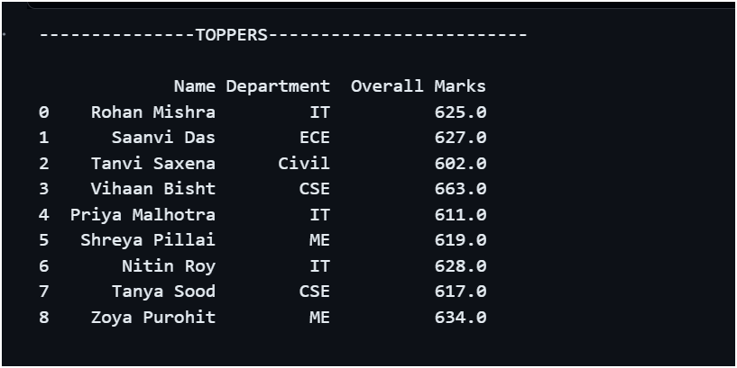
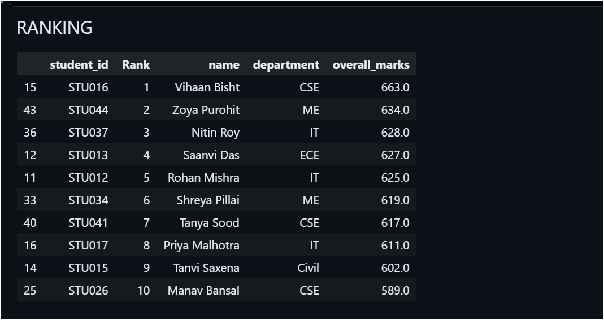
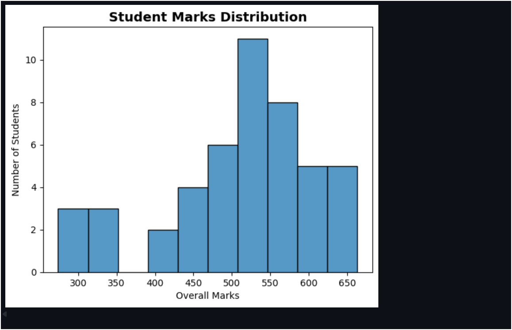
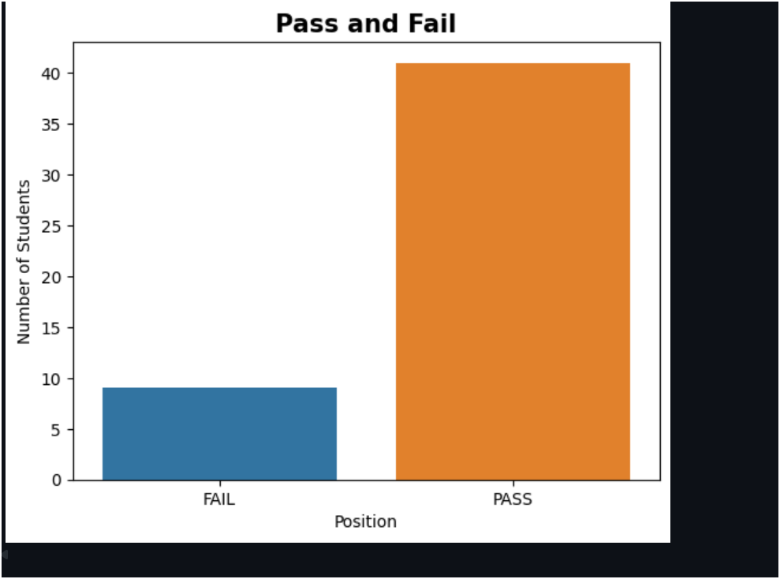

# Student Performance Analysis

## 1. Project Overview
Student Performance Analysis is a Python-based data analysis project that focuses on exploring student academic performance using marks, attendance, department, and sports scores.

## 2. Objectives
- To analyze students' academic marks.
- To compare performance across different departments.
- To examine student attendance and its relationship with academic performance.
- To explore sports scores alongside academic results.
- To practice data analysis and visualization using Python.

## 3. Dataset Description
The project uses a CSV dataset containing records of 50 students.

The dataset includes:
- Student ID and Name
- Department
- Mathematics, Physics, and Chemistry marks
- Programming Language and DSA marks
- Programming Language Lab and DSA Lab marks
- Attendance
- Sports Score

**Dataset file:** `student/student_details_50.csv`

## 4. Technologies Used
- Python
- Jupyter Notebook
- Pandas
- NumPy
- Matplotlib
- Seaborn

*Note: Keep only the libraries actually used in your notebook.*

## 5. Project Implementation

The Student Performance Analysis project is implemented using Python in Jupyter Notebook. The implementation involves the following steps:

1. **Loading the Dataset:** The student dataset is loaded from a CSV file using Pandas.
2. **Exploring the Data:** The dataset is examined to understand its columns, data types, and student records.
3. **Data Analysis:** Students' marks, attendance, departments, and sports scores are analyzed using Python.
4. **Performance Comparison:** Student data is compared to understand differences in academic performance.
5. **Data Visualization:** Graphs are created to represent the analyzed data wherever implemented in the notebook.

The implementation is contained in `EWB_Project.ipynb`, and the dataset is stored in `student/student_details_50.csv`.

## 6. Key Features

- **Student Data Analysis:** Analyzes student records using Python.
- 
- **Subject-Wise Performance:** Examines marks obtained in different subjects, including Mathematics, Physics, Chemistry, Programming Language, and DSA.
- 
- **Department-Wise Comparison:** Helps compare student records across different departments.
- 
- **Attendance Analysis:** Examines students' attendance data.
- 
- **Sports Score Analysis:** Includes sports scores for exploring student performance beyond academics.
- 
- **Data Visualization:** Presents analyzed information through graphs and charts, wherever implemented in the notebook.

## Output / Screenshots

### Graph 1

### Graph 2

### Graph 3

### Graph 4

##  Project Files--

- `EWB_Project.ipynb` — Jupyter Notebook containing the project code.
- `student/student_details_50.csv` — Student dataset.
- `README.md` — Project documentation.

## 7. How to Run the Project
1. Install Python and Jupyter Notebook.
2. Install the required libraries.
3. Keep the CSV file at the specified path.
4. Open `EWB_Project.ipynb` in Jupyter Notebook.
5. Run the notebook cells in order.

## 8. Final Outcome--

The Student Performance Analysis project successfully demonstrates the use of Python for analyzing student data. It provides a way to examine subject-wise marks, compare student records across departments, and explore attendance and sports scores.

The project helped in understanding how to work with CSV datasets, perform data analysis using Python libraries, and present information through graphs and visualizations.

Overall, the project provides practical experience in data analysis and helps organize student performance information for better understanding.

## 9. Challenges & Learning--

### Challenges Faced:

- Understanding and exploring the student dataset.
- Analyzing different types of data, such as subject marks, attendance, and sports scores.
- Presenting student data in a clear and understandable format.

### How the Challenges Were Addressed:

- Used Pandas to load and explore the CSV dataset.
- Used Python libraries to analyze the available student data.
- Used graphs and visualizations to represent information clearly.

### Learning Outcomes:

- Learned how to work with CSV files using Pandas.
- Improved practical knowledge of Python data analysis.
- Learned how to explore and compare student performance data.
- Gained experience in creating graphs and interpreting data.

## 10. Conclusion

This project provides an opportunity to explore student academic data and practice data analysis using Python. The final conclusions depend on the analysis and visualizations produced by the notebook.